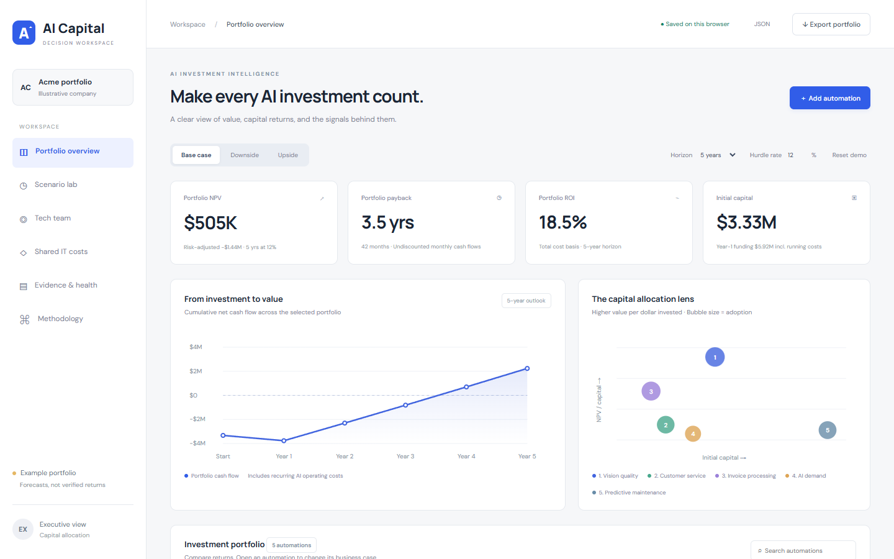
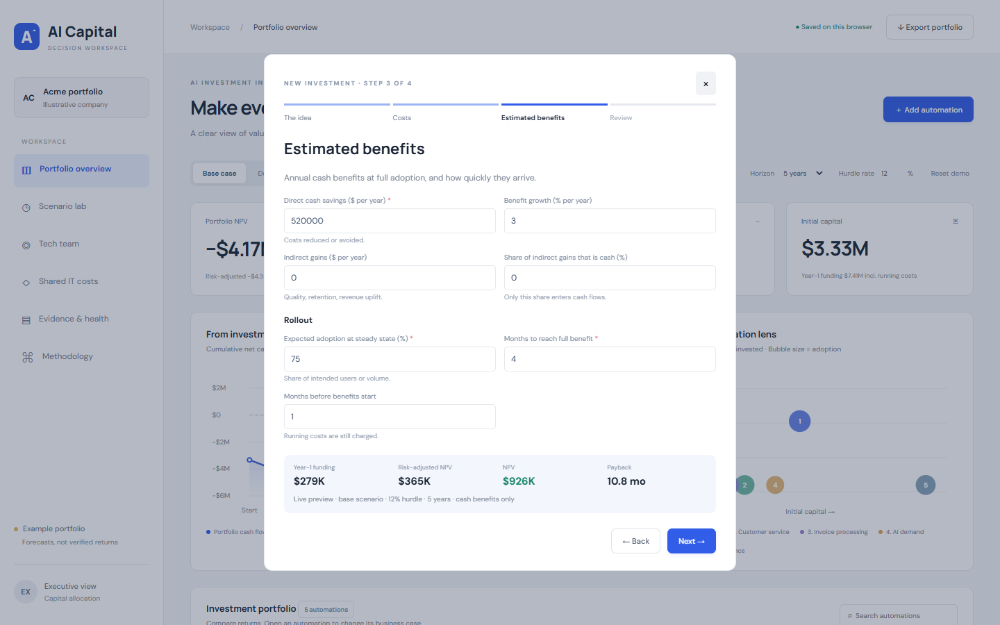
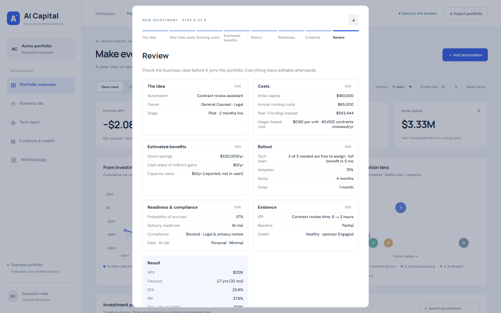
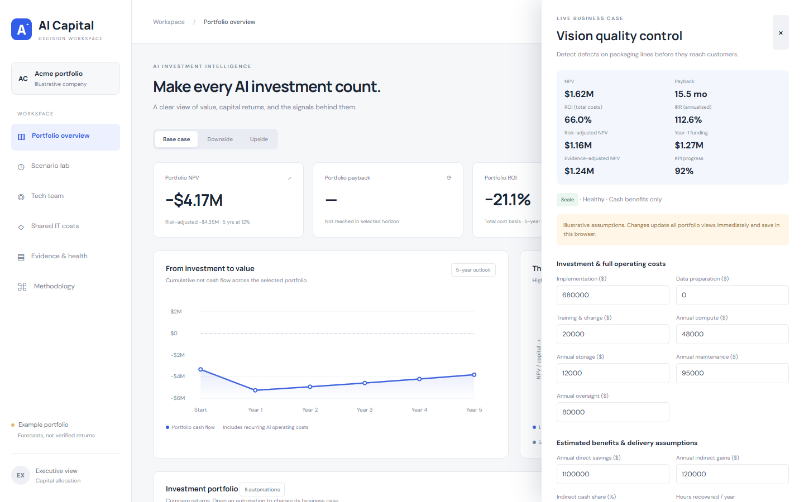
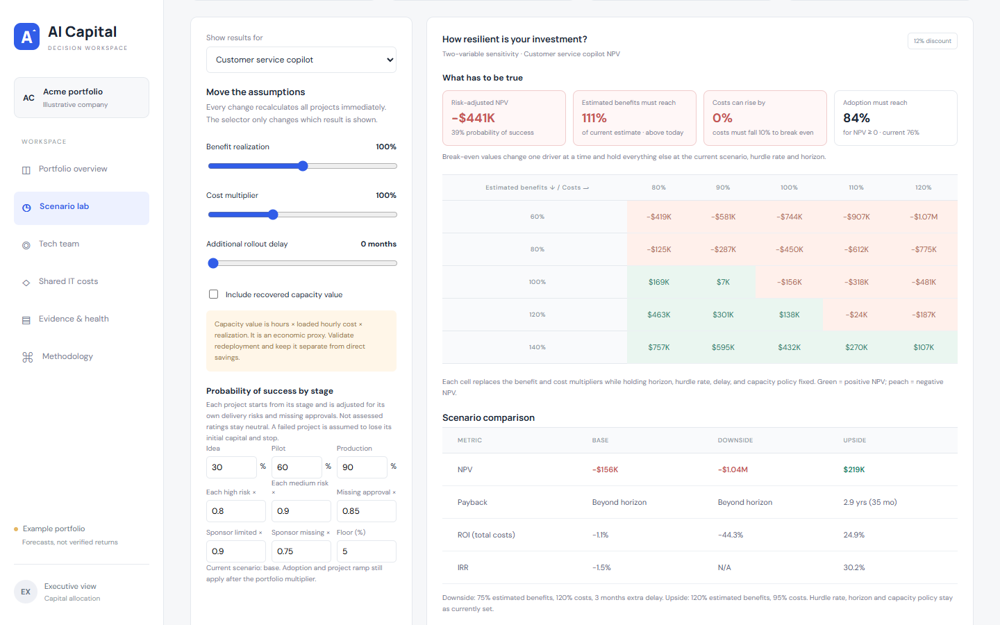
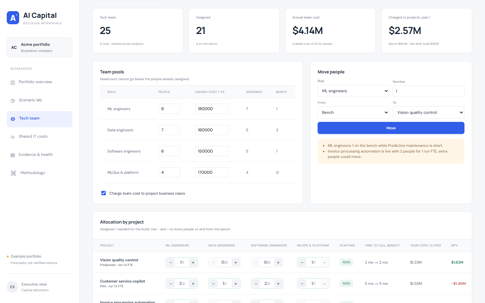
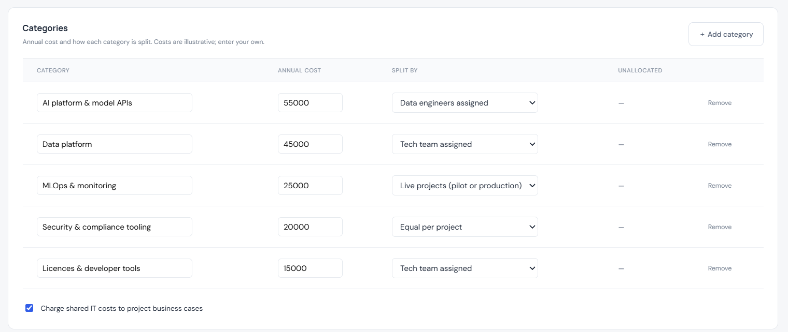
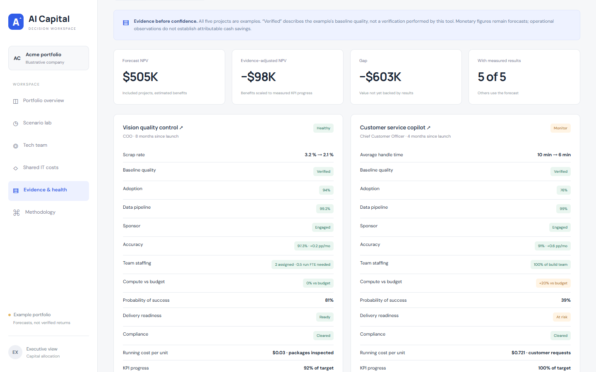

# AI Capital

An executive decision workspace for deciding which AI automation projects deserve money, people and continued support, and for checking whether funded projects are actually paying off. It models monthly cash flows for each project and the whole portfolio, and makes every assumption and formula visible.

Five editable illustrative projects use the reference's AI value, evidence and health framework.

## Why it matters

### For the CFO: put capital where the evidence is strongest

- **One consistent business case for every project.** NPV, payback, ROI and IRR all come from the same monthly cash model, discount rate and horizon, so a $200K copilot and a $1.5M platform can be compared fairly.
- **Know what you are committing.** Year-1 funding request (setup + first-year running costs), a funding plan by year, and total cost of ownership, kept separate from the return calculations so nothing is counted twice.
- **Fully loaded costs, counted once.** Shared IT costs are split by category and department into each business case, and each category is counted once in portfolio totals.
- **Inflated claims are filtered out.** Recovered hours are kept apart from real cash savings, only the cash share of indirect gains counts, and full running costs (compute, maintenance, oversight, internal team) are always included.
- **Risk is priced in.** Each project has its own probability of success, based on stage, delivery risks, sponsor engagement and missing approvals. Risk-adjusted NPV counts failure as losing the capital plus delivery spend. Overrides need a written reason.
- **Forecast vs evidence.** Evidence-adjusted NPV scales estimated benefits by the progress actually measured on each project's business KPI, so you can see how much of the forecast is backed by results.
- **What has to be true.** Break-even shows how far estimated benefits can fall, how far costs can rise and what adoption is needed before NPV reaches zero, alongside downside/upside scenarios and sensitivity tables.
- **Defensible decisions.** Rule-based Validate / Scale / Continue / Rework / Intervene recommendations, with cautions when value is not backed by risk or evidence. Every formula is on the Methodology page, and assumptions and results export to JSON.

### For the CTO: put people and platforms where they create value

- **The shared tech team as a real constraint.** A 25-person team by role (ML, data, software, MLOps & platform). Move people between projects and see the effect on delivery time, cost and NPV immediately.
- **Staffing drives timing.** Understaffing slows delivery in proportion, a missing role stalls a project, and extra people speed it up with diminishing returns. Bench and idle cost are shown, so the whole team's cost is accounted for.
- **Usage-based cost.** Cost per transaction × volume follows real adoption and ramp, with steady-state unit economics (cost, benefit and net per unit), since AI running costs grow with use.
- **Compute cost control.** Compute vs approved budget is a health signal, with the overrun's cost over the horizon.
- **Delivery readiness and compliance.** Data readiness, integration, vendor dependency and team capacity (set from actual staffing), plus security, legal and privacy, and model-risk approvals. A pilot or production project missing a required approval is flagged for intervention.
- **Operational health.** Adoption, data pipeline, model accuracy and trend, sponsor engagement, team staffing and compute, with escalation rules.
- **Shared IT costs charged fairly.** Platforms and tools are grouped into categories (AI platform & model APIs, data platform, MLOps & monitoring, security tooling, licences), each split by a basis that fits it and shown by department, so reuse and chargeback are visible.
- **A shared language with finance.** Technical risks feed the same probability, cost and timing that finance uses, so engineering trade-offs show up as dollars and months.

## Adding a project: the questionnaire

**＋ Add automation** opens a short questionnaire: four core steps build a complete business case, and four optional steps add detail when it is known. Nothing is copied from an example, so every number in a new case was entered on purpose.

**Core steps (about 20 questions)**

1. **The idea**: name, department, executive owner, stage and the problem it solves.
2. **Costs**: one-time costs (implementation, data preparation, training) and running costs (compute, storage, maintenance, human oversight).
3. **Estimated benefits**: direct cash savings, indirect gains and the share that is real cash, plus adoption, ramp-up and delay.
4. **Review**: the result (NPV, payback, ROI, risk-adjusted NPV, probability of success, recommendation), every section with an edit link, and warnings.

**Optional detail, added from Review**

- **Usage & capacity**: cost per transaction × volume, approved compute budget, and recovered hours (kept separate from cash).
- **Tech team**: people needed by role and run support; free people are assigned from the bench.
- **Readiness**: delivery risks, data sensitivity, AI risk level, and security, legal and model-risk approvals.
- **Evidence**: the business KPI with baseline, target and latest value, sponsor engagement and model health.

Skipped detail is never guessed: unrated risks stay neutral and are flagged, missing approvals block pilots, and without team needs no team cost or staffing delay is modelled. Review lists each of these as a warning. Required fields are checked before moving on, and a live preview of Year-1 funding, NPV, risk-adjusted NPV and payback updates as you type.

| A core step with the live preview | Review, with one detail step added |
|---|---|
|  |  |

## A tour of the workspace

**Project detail**: every assumption editable in place, with NPV, payback, ROI, IRR, risk-adjusted and evidence-adjusted NPV, Year-1 funding and a monthly cash audit.

**Scenario lab**: the whole portfolio or a single project, what has to be true to break even, base/downside/upside comparison and sensitivity tables.

**Tech team**: role pools, bench, moves between projects, and each project's staffing, time to full benefit, team cost and NPV.

**Shared IT costs**: platform and tooling costs grouped into categories, each split by its own basis (compute spend, data engineers, live projects, data sensitivity, people or equal), then totalled by department and charged to each project.

**Evidence & health**: forecast vs evidence-adjusted value, then per-project health, probability of success, readiness, compliance and unit cost.

Screenshots show the illustrative example portfolio, fully loaded with internal team and shared IT costs: a clear winner (Vision quality control), a smaller win (Invoice processing), a marginal case to rework (Customer service), and two pilots the tool flags for intervention. Both internal charges can be switched off (Tech team and Shared IT costs pages) to compare with the external-cost-only view.

## Export to Excel

**↓ Export portfolio** downloads an Excel workbook of the current portfolio in which every figure is a live formula. Change any blue input in Excel (a project's costs or adoption, the scenario, the hurdle rate, who is assigned to which project, a shared IT category's basis, the probability policy) and the whole workbook recalculates exactly as the app does.

| Sheet | What it holds |
|---|---|
| Overview | Portfolio cards and a row per project: NPV, risk- and evidence-adjusted NPV, payback, ROI, IRR, Year-1 funding, probability, health, readiness, compliance, recommendation |
| Settings | Hurdle rate, horizon, scenario (Base, Downside, Upside or Custom), cost switches, probability policy |
| Projects | Every input for every project, one row each |
| Team, Shared IT | Role pools; shared IT categories with the split by project and by department |
| P1, P2 … | One sheet per project: the 120-month cash schedule and every derived figure |
| Portfolio, Scenarios, Health | Summed flows, funding plan, break-even, sensitivity grids, health signals |

The workbook is built in the browser with no external libraries. `node tools/verify-excel.mjs` (Windows with Excel) generates workbooks for several app states, edits inputs inside Excel, and checks that Excel's results match the app's model: currently 1,301 values with no mismatches. To check a workbook that has been shared or edited, run `node tools/audit-workbook.mjs path/to/file.xlsx`: it lists formula errors, any formula that was overwritten or changed, and any result that no longer matches the model. JSON export remains available next to the button.

## Run it

Run `npm start` and open http://127.0.0.1:4173. Run `npm test` for the financial and portfolio checks. No install step is needed.

Read [architecture](docs/ARCHITECTURE.md), [implementation plan](docs/PLAN.md), [design](docs/DESIGN.md), [metrics and reference mapping](docs/METRICS.md), and [agent instructions](claude.md).

## Deploy on Vercel

Import the GitHub repository in Vercel. `vercel.json` already sets the output directory to `dist` with no build step, so the defaults work. Production URLs are public unless you enable Deployment Protection in the Vercel project settings.

## Scope

Data is saved in the current browser only. Figures are illustrative, nominal and before tax; projects are assumed independent. Live changes mean immediate assumption recalculation. Company accounts, shared storage, approval workflows, actual-vs-forecast tracking, telemetry integrations and a language-model agent are later phases.
