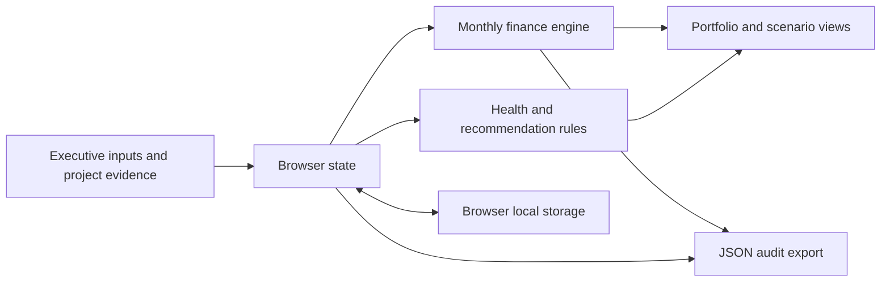

# Architecture

AI Capital is a browser-local executive portfolio application with a pure deterministic financial engine. It is deployed as a static site on Vercel (`vercel.json` serves `dist/`, no build step) and also runs locally without dependencies.

## Modules

- `dist/model.js`: pure finance engine, examples, staffing, probability, evidence, health, readiness and compliance rules.
- `dist/portfolio.js`: pure state logic: fresh state, saved-state migration and validation, portfolio aggregation, team usage and moves.
- `dist/wizard.js`: questionnaire field definitions and the draft → project builder.
- `dist/format.js`: display formatting and HTML escaping.
- `dist/xlsx.js`: dependency-free XLSX writer.
- `dist/excel.js`: live-formula workbook built from app state; its formulas mirror `model.js`.
- `dist/app.js`: browser state, rendering of all views, event binding and export.

Everything except `app.js` is DOM-free and covered by Node tests.

## Data model

Project includes identity, department, sponsor/owner, stage, initial implementation/data/training costs, annual compute/storage/maintenance/oversight costs, direct and indirect benefits, cash-qualified indirect share, recovered hours, hourly rate, realization percentage, adoption, launch delay, ramp, yearly growth, baseline quality, KPI baseline/current/target/unit, data pipeline health, sponsor engagement, accuracy target/trend, compute budget, project age and evidence notes; annual volume, unit and usage-based cost per unit; delivery-risk ratings, data sensitivity, AI risk level and three approval statuses; tech team need by role, current allocation and run-support FTE; and an optional probability override with a required reason.

Portfolio settings include effective annual discount rate, investment horizon, benefit multiplier, cost multiplier, additional rollout delay, capacity inclusion policy, probability-of-success policy (stage starting points, risk, sponsor and approval factors, floor), and the shared tech team (roles, headcount, loaded cost, and whether team cost is charged). Inclusion IDs select which projects aggregate into the portfolio. Recommendations remain per-project even if excluded from aggregation.

## Calculation pipeline

1. Build project cash schedule from assumptions, never from rounded display values.
2. Compute initial investment and full annual operating expenses.
3. Allocate shared IT categories across all projects by each category's basis; each share is a fixed monthly cost.
4. Derive staffing coverage from the shared team; scale project delay and ramp by it, and charge build then run team cost.
5. Apply indirect cash share and optional capacity proxy, adoption, delays, ramp, usage-based costs and scenario factors.
6. Grow costs and benefits at annual boundaries and calculate monthly cash flows.
7. Calculate NPV, annualized IRR, payback at final recovery of cumulative cash, discounted payback, horizon ROI, capital ROI, Year-1 funding, break-even, unit economics, compute overrun cost, and risk- and evidence-adjusted NPV.
8. Aggregate included monthly flows before portfolio IRR/payback, using the same payback rule; do not average project IRRs.
9. Derive transparent health signals, readiness, compliance, recommendation and cautions separately.

## Persistence and security

State is saved in `localStorage` under `ai-capital-v1`. Saves from earlier versions are migrated: missing fields come from the matching example or neutral defaults, and existing edits are kept. Invalid persisted shape falls back to examples. Failed storage remains usable for the current session. Project text is escaped before inserting into markup. The local HTTP server confines file requests to `dist/`. The private hosted audience controls access to the demo, but the application itself has no tenant authentication. No sensitive company data should be inferred to sync across browsers.

## Production architecture

Add a company tenant, authenticated role mapping (CFO, sponsor, analyst, viewer), and server-side authorization. Store versioned projects, benefit ledger, costs, observed KPI measurements, scenario snapshots, and approval records in a tenant-scoped database. Evidence uploads belong in private object storage. All changes need immutable author/time/version audit events. Recalculate on the server and client from the same versioned engine for reviewable results.

Actual benefit observations must retain period, source, baseline window, cohort, attribution method, owner and confidence. Separate ledger entries for hard savings, avoided spend, margin contribution, and capacity prevent duplicate claims. Shared infrastructure allocation and linked project dependencies precede portfolio optimization.

An optional language model can draft an executive narrative using a structured, versioned calculation result. It must cite input evidence, identify missing fields, and never invent a financial number or commit funding. Approval remains a named human action.

## Verification

Numerical tests use independent annuity values, known monthly schedules, delayed deployment, adoption, capacity exclusions, sensitivity monotonicity, nonconventional IRR, early warning boundaries, break-even round trips, staffing, probability, evidence and compute rules. Portfolio tests cover saved-state migration and validation, aggregation, team moves and the questionnaire builder. Workbook tests cover structure and formula well-formedness; `tools/verify-excel.mjs` opens exported workbooks in Excel, applies input edits there, and compares every result with the model. Browser verification covers the portfolio, the questionnaire, live edits, scenarios, the tech team page, persistence, evidence and responsive layout.
