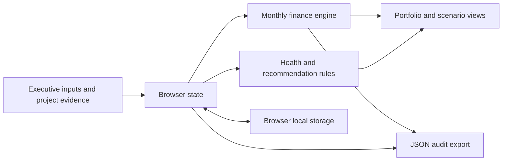

# Architecture

AI Capital is a browser-local executive portfolio application with a pure deterministic financial engine. It is delivered as a static private Site and also runs locally without dependencies.

## Data model

Project includes identity, department, sponsor/owner, stage, initial implementation/data/training costs, annual compute/storage/maintenance/oversight costs, direct and indirect benefits, cash-qualified indirect share, recovered hours, hourly rate, realization percentage, adoption, launch delay, ramp, yearly growth, baseline quality, KPI baseline/current/target/unit, data pipeline health, sponsor engagement, accuracy target/trend, compute budget, project age and evidence notes.

Portfolio settings include effective annual discount rate, investment horizon, benefit multiplier, cost multiplier, additional rollout delay, and capacity inclusion policy. Inclusion IDs select which projects aggregate into the portfolio. Recommendations remain per-project even if excluded from aggregation.

## Calculation pipeline

1. Build project cash schedule from assumptions, never from rounded display values.
2. Compute initial investment and full annual operating expenses.
3. Apply indirect cash share and optional capacity proxy, adoption, delays, ramp and scenario factors.
4. Grow costs and benefits at annual boundaries and calculate monthly cash flows.
5. Calculate NPV, annualized IRR, first cash-flow payback, discounted payback, horizon ROI and capital ROI.
6. Aggregate included monthly flows before portfolio IRR/payback; do not average project IRRs.
7. Derive transparent health signals and executive action recommendation separately.

## Persistence and security

State is saved in `localStorage` under `ai-capital-v1`. Invalid persisted shape falls back to examples. Failed storage remains usable for the current session. Project text is escaped before inserting into markup. The local HTTP server confines file requests to `dist/`. The private hosted audience controls access to the demo, but the application itself has no tenant authentication. No sensitive company data should be inferred to sync across browsers.

## Production architecture

Add a company tenant, authenticated role mapping (CFO, sponsor, analyst, viewer), and server-side authorization. Store versioned projects, benefit ledger, costs, observed KPI measurements, scenario snapshots, and approval records in a tenant-scoped database. Evidence uploads belong in private object storage. All changes need immutable author/time/version audit events. Recalculate on the server and client from the same versioned engine for reviewable results.

Actual benefit observations must retain period, source, baseline window, cohort, attribution method, owner and confidence. Separate ledger entries for hard savings, avoided spend, margin contribution, and capacity prevent duplicate claims. Shared infrastructure allocation and linked project dependencies precede portfolio optimization.

An optional language model can draft an executive narrative using a structured, versioned calculation result. It must cite input evidence, identify missing fields, and never invent a financial number or commit funding. Approval remains a named human action.

## Verification

Numerical tests use independent annuity values, known monthly schedules, delayed deployment, adoption, capacity exclusions, sensitivity monotonicity, nonconventional IRR and early warning boundaries. Browser verification covers the portfolio, adding investments, live edits, scenarios, persistence, evidence and responsive layout.
